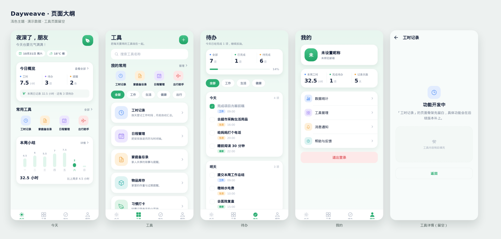

# Dayweave

<div align="center">

**生活助手 · 把今天，织成你想要的样子。**

一个基于 **Expo + React Native + TypeScript + Supabase** 的生活助手应用基础工程。

[](https://expo.dev/)
[](https://reactnative.dev/)
[](https://www.typescriptlang.org/)
[](https://supabase.com/)
[](https://jestjs.io/)

</div>

## 项目简介

Dayweave 是一个面向个人生活场景的助手工具。当前仓库处于**基础工程初始化阶段**，已经搭好后续功能开发所需的通用底座：

- 邮箱注册 / 登录 / 退出，Supabase 会话持久化；
- 与 family-piggy 共用用户昵称、头像、家庭与成员关系，支持编辑昵称 / 头像链接、家庭改名及手动刷新；
- 登录态与未登录态路由切换；
- 「今天 / 工具 / 待办 / 我的」四 Tab 应用外壳与页面大纲；
- 工时：任务（预计工时、时间范围、完成状态）下挂分钟级工时记录，任务与记录都可删除；
- 可配置卡片：从注册表挑卡片、调顺序，配置按用户存在本地；
- 工具详情占位页（未实现的工具仍走占位版式）；
- 亮色 / 暗色主题、统一设计令牌与基础 UI 组件；
- Supabase 行级安全（RLS）初始化脚本；
- Jest 离线测试、TypeScript 严格类型检查与 GitHub Actions CI。

> Dayweave 只复用 family-piggy 的身份与家庭基础数据，不引入记账界面；工时等生活助手业务仍独立存储，家庭成员不会因此自动获得个人工时访问权。

## 页面大纲

当前阶段先把页面风格与信息结构定下来。「今天」与「我的」的卡片已经接上真实工时数据，卡片本身可以通过页面上的「配置」入口增删和排序；「待办」页与尚未实现的工具仍是示例数据与占位骨架。



| 页面 | 内容 | 预览 |
| --- | --- | --- |
| 今天 | 问候与日期、可配置数据卡片、常用工具快捷入口 | [`today.png`](./docs/preview/today.png) |
| 工具 | 搜索、我的常用、分类筛选、工具列表 | [`tools.png`](./docs/preview/tools.png) |
| 待办 | 完成度概览、分类筛选、今天 / 明天分组 | [`tasks.png`](./docs/preview/tasks.png) |
| 我的 | 用户信息、可配置数据卡片、设置入口、退出登录 | [`profile.png`](./docs/preview/profile.png) |
| 工具详情 | 标题栏 + 留白占位，等待具体功能填充 | [`tool-detail.png`](./docs/preview/tool-detail.png) |
| 工时记录 | 任务列表与进度、任务内记工时、手动完成 / 删除任务 | — |
| 任务编辑 | 任务名、描述、预计工时、起止日期 | — |

设计语言：浅薄荷到近白的竖向渐变背景、白色圆角卡片、深靛蓝标题、`#2CAE73` 主色与马卡龙色系图标底色；四个 Tab 各有专属语义图标与选中态色块，亮色 / 暗色下都有对应取值。预览图由 `node scripts/render-preview.js` 用真实组件渲染导出（`react-native-web` SSR + 无头浏览器截图），仅作为版式参考；改动页面或底部标签样式后重跑脚本即可刷新这 6 张图。

## 技术栈

| 类别 | 选型 |
| --- | --- |
| 语言 | TypeScript 5.3，`strict: true`，统一使用 `@/` 别名 |
| 客户端 | Expo SDK 52 + React Native 0.76 + React 18 |
| 状态管理 | zustand 5 |
| 后端 | Supabase Auth + Postgres + RLS |
| 路由 | React Navigation 7（native-stack + bottom-tabs） |
| 本地存储 | `@react-native-async-storage/async-storage` |
| 测试 | Jest + jest-expo + React Native Testing Library |
| CI | GitHub Actions |

## 目录结构

```text
dayweave
├─ src/
│  ├─ components/    通用 UI 组件
│  ├─ domain/        与框架无关的纯函数与业务规则
│  ├─ hooks/         跨组件复用逻辑
│  ├─ lib/           Supabase client、提示框、错误归一化
│  ├─ navigation/    路由注册与参数类型
│  ├─ screens/       页面
│  ├─ services/      Supabase 数据访问
│  ├─ stores/        zustand 全局状态
│  ├─ test/          测试替身
│  ├─ theme/         调色板、间距、圆角、字号
│  └─ types/         领域类型与数据库行类型映射
├─ .github/          CI、发布构建与缓存预热工作流；scripts/ 为 Gradle 调优脚本
├─ docs/preview/     页面大纲预览图
├─ supabase/         schema.sql 与后续 migrations
├─ App.tsx           根编排
└─ index.ts          Expo 入口
```

## 快速开始

### 1. 安装依赖

```bash
npm install
```

### 2. 配置 Supabase

1. 在 [supabase.com](https://supabase.com) 创建项目。
2. 先部署 family-piggy 的共享基础结构（`profiles`、`families`、`family_members`、`rename_family` 及其 RLS、注册触发器和头像存储桶）。再在 Dashboard → SQL Editor 执行 [`supabase/schema.sql`](./supabase/schema.sql)。已有 Dayweave 环境按下文执行共享资料迁移，不要重新部署旧版资料表。
3. 在 Authentication → Providers 中启用 Email 登录，并按需选择是否开启邮箱验证。
4. 复制环境变量模板：

```bash
cp .env.example .env
```

填写 Supabase 项目地址与 Anon Key：

```dotenv
EXPO_PUBLIC_SUPABASE_URL=https://<your-project>.supabase.co
EXPO_PUBLIC_SUPABASE_ANON_KEY=<your-anon-key>
```

`.env` 已被 `.gitignore` 忽略。真实密钥、keystore、token 不得提交到仓库。

### 3. 启动应用

```bash
npm start
# 或直接打开指定平台
npm run web
npm run android
npm run ios
```

## 常用脚本

| 命令 | 作用 |
| --- | --- |
| `npm start` | 启动 Expo 开发服务器 |
| `npm run web` | 以 Web 方式启动 |
| `npm run android` | 启动 Android |
| `npm run ios` | 启动 iOS |
| `npm run typecheck` | TypeScript 严格检查 |
| `npm test` | 运行 Jest 测试 |
| `npm run check` | 类型检查 + CI 模式测试 |

提交前必须执行：

```bash
npm run check
```

## 当前数据库

[`supabase/schema.sql`](<supabase/schema.sql>) 创建两张 Dayweave 业务表：

- `dw_work_tasks`：工时任务，含 `estimated_minutes`（分钟）、`start_date` / `due_date`、`status`（`open` / `done`）；
- `dw_work_logs`：挂在任务下的工时记录，含 `content`、`minutes`、`work_date`；删除任务时由外键级联删除。

两张表都启用 RLS，只允许用户读写自己的行（`auth.uid()`），并只授予 `authenticated` 需要的权限。

### 共用用户与家庭

- 用户资料统一使用 `profiles.nickname` / `avatar_url`，主键就是 Supabase Auth 用户 ID；不再读写 `dw_profiles`，注册 metadata 统一传 `nickname`。同账号可在两应用分别登录，不是自动跨应用登录。
- 家庭与成员关系使用 `families`、`family_members`。入口在「我的」菜单的「家庭管理」，与「数据统计」同组，首页不再展开家庭列表。管理页支持选择当前家庭（即主家庭）、凭 8 位邀请码加入、创建者改名和普通成员退出；改名调用既有 `rename_family` RPC，同步家庭账本名，加入只走 `join_family` 验证邀请码，不直接新增成员关系。
- 当前家庭选择按账号保存于本设备，首次默认第一个家庭；退出或刷新后原选择不可用时，回落到仍有效的第一个家庭，没有家庭则清空。此选择不更改其他家庭成员的默认家庭，也不修改 family-piggy 的当前账本偏好。
- 退出前二次确认，只移除自己的成员关系，不删除家庭和历史账务；家庭创建者不可直接退出，家庭创建 / 解散仍在 family-piggy 完成。
- 「我的」资料卡在名字、邮箱右侧提供紧凑编辑 / 刷新图标；点击头像打开头像编辑，可从相册选择上传至共用 `avatars` 存储桶、填写公开图片链接或确认移除头像。昵称及头像修改使用应用内弹窗，family-piggy 上传的头像也可直接展示。
- 完整资料 / 家庭 / 成员快照按账号缓存在 AsyncStorage，成功读取后 **24 小时**过期；启动、回到前台和每日检查时按需拉取，手动刷新绕过缓存。无 Realtime 订阅，也不会后台定时联网。刷新失败保留旧数据并展示错误，不延长缓存期限。
- 保存昵称或家庭名会更新本地缓存，但不会延长其他共享数据的过期时间。登出和切换账号清空内存，未完成的旧请求不能覆盖新账号资料。
- family-piggy 现有资料页在重新进入时刷新；修改共享数据后，其已打开页面不会立即变化，可重新进入页面查看。本文不承诺另一个客户端的一天缓存策略。

**已有环境升级**：先备份，再在 SQL Editor 执行[共享资料迁移](<supabase/migrations/20261107000000_use_shared_profiles_and_families.sql>)。脚本要求共享结构已存在，为缺失历史用户补齐共享资料，以现有共享非空资料为准，只用旧资料补空值；完成后删除旧 `dw_profiles` 和其注册触发器，不保留双写。迁移不会创建个人账本，不改变已有家庭权限。应用发布不会自动执行数据库迁移。

**权限提醒**：family-piggy 原有 `family_members_insert` 仅检查 `user_id = auth.uid()`，未强制邀请码验证；Dayweave 的加入入口只调用现有 `join_family` RPC，不直接插入成员，不改写共享权限。底层既有策略仍需在 family-piggy 侧统一收紧，避免其他客户端绕过邀请码；本次客户端更新不等同于修复该数据库策略。

### 表名前缀约定

同一个 Supabase 项目会被多个应用共用，因此本项目**自建**数据库对象统一使用 `dw_` 前缀：例如 `dw_work_tasks`、`dw_work_tasks_select_own` 和 `dw_set_updated_at`。共享的 `profiles`、`families`、`family_members` 与家庭 RPC 由 family-piggy 管理，是明确的复用例外，不再额外建一套同义对象。命名细节见 [`AGENTS.md`](./AGENTS.md) 的 3.3 节。

新增业务表时：

1. 写入 `supabase/migrations/<timestamp>_<name>.sql`；
2. 同步更新 `supabase/schema.sql`；
3. 表名使用 `dw_<业务>`，策略 / 触发器 / 函数同样带 `dw_` 前缀；
4. 为表启用 RLS 并编写策略；
5. 需要实时同步时再加入 `supabase_realtime` publication。

## 构建与发布

Android APK 完全在 GitHub Actions Runner 上构建，**不依赖 Expo / EAS 账号**：CI 内先 `expo prebuild` 生成原生工程，再用 Gradle 打包并签名。JDK 17 与 Android SDK 由 Runner 自带。

CI 工作流：

| 工作流 | 触发 | 内容 |
| --- | --- | --- |
| [`.github/workflows/ci.yml`](./.github/workflows/ci.yml) | push / PR 到 `main` | `npm ci` → `npm run typecheck` → `npm test -- --ci` |
| [`.github/workflows/warm-android-cache.yml`](./.github/workflows/warm-android-cache.yml) | 依赖 / 配置变更或手动触发 | 在 `main` 作用域预热 Gradle 缓存 |
| [`.github/workflows/release.yml`](./.github/workflows/release.yml) | 推送 `v*` 标签或手动触发 | 构建、签名并发布 Android APK |

### 触发方式与产物

```bash
# 正式发布：推送 annotated tag
git tag -a v0.1.0 -m "v0.1.0：一句话主题

- 用户可感知的改动"
git push origin v0.1.0
```

| 触发方式 | 发布标签 | 说明 |
| --- | --- | --- |
| 推送 `v*` 标签 | 该标签（如 `v0.1.0`） | 正式 Release |
| 手动 Run workflow | `build-<run_number>` | 预发布，便于随时获取安装包 |

产物发布在仓库 **Releases** 页面的 Assets 中，文件名形如 `dayweave-<tag>.apk`，可直接点击下载安装，无需解压。同一标签重跑会覆盖同名资产。

### 环境变量与版本号注入链路

```text
GitHub Secrets
  └─ EXPO_PUBLIC_SUPABASE_URL / EXPO_PUBLIC_SUPABASE_ANON_KEY
       └─ Gradle assembleRelease 触发 Metro 打包时内联进 bundle

github.run_number → ANDROID_VERSION_CODE → app.config.js 的 android.versionCode（每次构建递增）
tag v0.1.0        → APP_VERSION          → app.config.js 的 version（去掉 v 前缀）
```

签名不走「修改 build.gradle」，而是用 Gradle 官方注入属性（与 Android Studio 同款）在 `assembleRelease` 命令行传入，prebuild 生成的工程保持原样：

```bash
./gradlew assembleRelease \
  -Pandroid.injected.signing.store.file="$KEYSTORE_FILE" \
  -Pandroid.injected.signing.store.password="$KEYSTORE_PASSWORD" \
  -Pandroid.injected.signing.key.alias="$KEY_ALIAS" \
  -Pandroid.injected.signing.key.password="$KEYSTORE_PASSWORD"
```

PKCS12 keystore 的 key 密码与 store 密码相同，因此只需要一个密码 Secret。

<details>
<summary><strong>首次打包一次性准备：keystore + GitHub Secrets</strong></summary>

1. **签名 keystore**：本项目已生成一把放在本地 `.secrets/`（见 `.secrets/android-signing-credentials.txt`），别名 `dayweave`，务必自行离线备份；丢失后无法覆盖升级已安装的 App。如需自行重新生成：

```bash
keytool -genkeypair -v -storetype PKCS12 \
  -keystore release.keystore \
  -alias dayweave \
  -keyalg RSA -keysize 2048 -validity 10000
```

2. **将 keystore 转为 Base64（单行）**：

```bash
# macOS / Linux
base64 -w0 release.keystore

# Windows PowerShell
[Convert]::ToBase64String([IO.File]::ReadAllBytes("release.keystore"))
```

keystore 已被 `.gitignore` 忽略（`*.keystore` / `*.jks` / `.secrets/`），不要提交。

3. **在 GitHub 仓库 Settings → Secrets and variables → Actions 配置 5 个 Secrets**：

| Secret | 说明 |
| --- | --- |
| `SUPABASE_URL` | Supabase 项目 URL |
| `SUPABASE_ANON_KEY` | Supabase Anon Key |
| `ANDROID_KEYSTORE_BASE64` | keystore 的 Base64 单行文本 |
| `ANDROID_KEYSTORE_PASSWORD` | keystore 密码（PKCS12 下 key 密码与其相同） |
| `ANDROID_KEY_ALIAS` | keystore 别名（本项目为 `dayweave`） |

> `SUPABASE_*` 会被内联进客户端 bundle，属公开信息；**真正需要保密的是 keystore 与其密码**。

4. **应用图标与原生开屏**：使用 [`dayweave-icon.png`](./dayweave-icon.png) 生成的 [`assets/icon.png`](./assets/icon.png)（1024×1024、四边无泛白）和 [`assets/adaptive-icon.png`](./assets/adaptive-icon.png)（主体收在 Android 安全区内、外圈用图标自身色调延展）。生成脚本 [`scripts/generate-icons.js`](./scripts/generate-icons.js) 自带 [`scripts/png.js`](./scripts/png.js) 编解码，不依赖第三方图像库；它会先找到内容区、把裁切边收进不泛白的位置，再收敛边缘发光，所以原图四周的白底与柔和投影不会变成图标上的白边。[`app.config.js`](./app.config.js) 已配置应用图标、自适应图标及亮暗原生启动屏；修改后需重新构建安装包才生效。更换原图后运行 `node scripts/generate-icons.js` 重新生成，`npm run check` 会检查资源尺寸、边缘亮度与 Android 安全区。

</details>

<details>
<summary><strong>构建失败排查</strong></summary>

| 现象 | 原因与处理 |
| --- | --- |
| `Plugin [id: 'expo-module-gradle-plugin'] was not found` | `node_modules` 混入其他 SDK 版本的原生模块；运行 `npx expo install --check`，再用 `npx expo install <包名>` 装回期望版本 |
| `Could not get unknown property 'release' for SoftwareComponent container` | 通常是上一条版本错配的连带报错，依赖对齐后消失 |
| APK 仍是 debug 签名 | keystore Secrets 未生效，检查 `ANDROID_KEYSTORE_BASE64` / 密码 / 别名；工作流里的 `校验 APK 签名` 步骤会直接失败 |
| 发布构建卡在下载 `gradle-*-all.zip` | 到 Actions 手动触发一次 **Warm Android Cache**，或 push `package.json` / `package-lock.json` 预热 main 缓存 |

</details>

> 发布工作流需要 `contents: write` 权限来创建 Release（已在 `release.yml` 中声明）。若仓库或组织策略将默认 `GITHUB_TOKEN` 限制为只读，请到 Settings → Actions → General → Workflow permissions 调整为 “Read and write permissions”。

> 当前 CI 只产出 **Android APK**。AAB（上架 Google Play）与 iOS 正式包尚未接入：iOS 必须 Apple 付费开发者账号 + macOS Runner，AAB 需要补一条 `bundleRelease` 流水线。

## 架构约定

依赖方向：

```text
screens ──► stores ──► services ──► lib/supabase
   │           │           │
   └───────────┴───────────┴──► domain
                                types / theme
```

- `domain/` 只放纯函数，不依赖 React、Supabase 或 store；
- `services/` 是唯一允许直接访问 Supabase 的业务层；
- `stores/` 负责状态编排，不写 SQL，不直接调用 Supabase；
- `screens/` 只做交互与页面编排，复杂计算下沉；
- 数据库行类型只在 `types/db.ts` 定义并统一转换；
- UI 颜色、间距、字号统一从 `theme/` 取，不散落硬编码。

更详细的开发规则见 [`AGENTS.md`](./AGENTS.md)。

## 通用弹窗与选择器

所有提示、确认与日期 / 时间选择都使用应用内组件绘制，不再调用 `Alert.alert` / `window.confirm`，也不使用平台原生日期、时间滚轮；Web、Android、iOS 的视觉与交互保持一致。

| 场景 | 入口 | 返回值 |
| --- | --- | --- |
| 消息提示 | `showMessage(title, message?, options?)` | `Promise<void>` |
| 二次确认 | `confirmAction({ title, message?, confirmText?, cancelText?, destructive? })` | `Promise<boolean>` |
| 选择日期 | `pickDate({ title?, initial?, min?, max?, ... })` | `Promise<Date \| null>` |
| 选择时间 | `pickTime({ title?, initial?, minuteStep?, ... })` | `Promise<TimeValue \| null>` |

业务代码只从 `src/lib/alert.ts` 与 `src/lib/picker.ts` 发起请求，`DialogHost` 挂在 `App.tsx` 根节点统一渲染。请求按调用顺序排队；点遮罩或返回键关闭时返回各自的取消值（消息 `undefined`、确认 `false`、选择器 `null`）。

```ts
const day = await pickDate({ title: '记录日期' });
if (!day) return; // 用户取消
```

组件清单：

- `src/components/ui/DialogSheet.tsx` — 通用容器：墨绿遮罩、白色圆角卡、语义图标、220ms 淡入上滑；系统开启「减少动态效果」时自动去掉动画。
- `src/components/ui/DatePicker.tsx` — 周一起始、固定 6 行的月历，支持可选范围与今日标记。
- `src/components/ui/TimePicker.tsx` — 时 / 分两列滚动选择，分钟刻度可配置（默认 5 分钟）。
- `src/components/ui/DialogHost.tsx` — 弹窗队列宿主，按类型分派内容与结果。

设计令牌全部取自 `src/theme`，其中新增 `Colors.backdrop` 提供亮暗两套遮罩色。月历与时间计算分别收敛在 `src/domain/calendar.ts`、`src/domain/time.ts`，都是可注入固定时间的纯函数。开发环境下底部导航会多出「组件预览」Tab，可逐个查看四种效果；生产构建不包含该 Tab。

## 应用内更新

「我的」页底部有**应用更新**卡片：检查 GitHub 最新正式 Release → 比对版本 → 下载 APK → 校验大小 → 拉起系统安装器。不自动联网，全部由用户手动触发，可忽略某个版本。

| 环节 | 说明 |
| --- | --- |
| 检查更新 | 匿名读取 `api.github.com/repos/sprogFall/dayweave/releases/latest`，天然排除草稿与预发布；仓库需公开，否则返回 404 并显示「暂时无法获取更新信息」 |
| 下载地址 | 优先级为 Release 说明里声明的镜像 → 代理 → GitHub 直连，逐个重试并去重 |
| 代理配置 | `EXPO_PUBLIC_UPDATE_PROXY_PREFIX`（默认 `https://gh-proxy.com/`）；置为空字符串可禁用代理。只代理 `github.com/.../releases/download/...` 的 https 资产 |
| 自定义镜像 | 在 Release 正文写一行 `APK-Mirror: https://<镜像地址>` 即可，支持多行、自动去重 |
| 完整性 | 校验 GitHub 提供的资产大小；APK 是否被篡改由 Android 安装器的签名校验兜底，因此不做大文件流式哈希，避免拖慢安装 |
| 安装 | 仅 Android；`app.config.js` 已声明 `REQUEST_INSTALL_PACKAGES`，首次安装需授予「安装未知应用」权限，卡片会给出授权入口 |

实现分层：`src/domain/app-version.ts` 与 `src/domain/update.ts` 放纯计算，`src/types/github.ts` 负责 API 行映射，`src/services/update.service.ts` 访问网络与文件系统，`src/stores/update.store.ts` 编排状态，`src/components/UpdateCard.tsx` 负责展示。

## 测试

```bash
npm test
npm run test:watch
```

测试必须离线、确定、快速。纯逻辑、service、store 的新增或修改必须补测试；bug 修复必须补回归测试。

## 后续方向

以下只是生活助手可生长的方向，不代表当前已实现：

- 日程与提醒；
- 习惯与目标；
- 随记与灵感；
- 每日回顾与统计；
- 多设备同步与离线缓存。

功能落地前先更新本文档、数据库迁移与 `AGENTS.md` 中相关约定，避免工程结构与产品方向脱节。

## 安全说明

- 客户端只使用 Supabase Anon Key，service role key 绝不进入 App；
- 所有用户数据表必须启用 RLS；
- 不提交 `.env`、真实用户数据、调试响应转储、签名文件；
- 涉及删除等危险操作时，界面必须二次确认。
